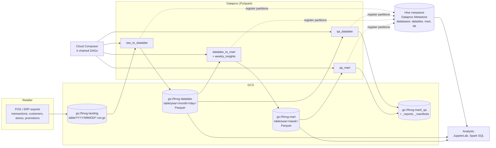
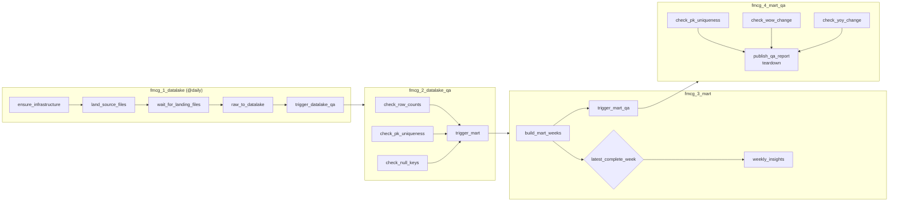

# System design: FMCG retail data pipeline on GCP

This page explains how the system is put together, one step at a time. Follow it in order and you can redraw the design on a whiteboard.

## 1. Problem and requirements

An FMCG retailer (49 stores across India, a loyalty programme, regular promotions) sends its daily data as gzipped CSV files. The business wants weekly sales reporting by store, category, brand, promotion and customer tier, with checks that catch duplicates and unusual swings before anyone reads the numbers.

| Type | Requirement | How the design meets it |
|---|---|---|
| Functional | Land raw files in GCS as `.csv.gz` | Landing bucket, one folder per table per day |
| Functional | Raw Parquet layer partitioned by year, month, day | `datalake` Hive database on `gs://fmcg-datalake` |
| Functional | Business layer partitioned by year and ISO week | `mart` Hive database on `gs://fmcg-mart` |
| Functional | Query with SQL and PySpark (`spark.table`, `spark.sql`) | Hive metastore shared by Spark jobs, SQL shell and JupyterLab |
| Quality | Primary keys unique; WoW change within ±20%; YoY within ±40% | Two QA DAGs writing results to `qa` Hive tables |
| Lineage | Every row traceable to its source file | `filename` and `modified_dttm` columns on every datalake table |
| Re-runnable | Any day or range can be reloaded with the same result | Partition overwrite (delete prefix, write, re-register) |
| Volume | 3 years: 1,096 days, 3.56 M transaction lines, 157 weeks | Range runs write many partitions in one Spark job |

## 2. Architecture (production, GCP)



## 3. Local stand-ins

Real GCP was not used for the runs (no billing account), so each service has a local twin. Switching is one setting: `GCS_MODE=real` in `common/config.py`.

| Production | Local in this repo |
|---|---|
| Google Cloud Storage | `fake-gcs-server` emulator in Docker (port 4443), reached through the real GCS Hadoop connector |
| Dataproc Metastore | Hive metastore 2.3 schema on Postgres in Docker (port 5433) |
| Dataproc | PySpark 4 in local mode |
| Cloud Composer | Airflow 3.2 standalone (`airflow/dags/`) |
| Cloud Shell `gsutil` | `gsutil` with a separate gcloud config pointed at the emulator (works inside the notebook too) |

## 4. One day of data, step by step

**Step 1. The retailer drops four files** (`generator/generate_fmcg_drop.py`). For each day: `transactions_YYYYMMDD.csv.gz`, `customers_...`, `stores_...`, `promotions_...` go to `gs://fmcg-landing/<table>/YYYY/MM/DD/`. The generator builds realistic patterns: 9% yearly growth, 5% price inflation, Diwali and Holi peaks on their real dates, monsoon dips, new stores opening, and about 0.5% duplicate POS lines. A day with no promotion changes still gets a header-only file, so "no data" is different from "file missing".

**Step 2. Wait for the files** (`scripts/check_landing.py`). An Airflow sensor checks that all four files exist for every day in the run before Spark starts. It runs in reschedule mode, so it does not hold a worker slot while waiting.

**Step 3. Landing to datalake** (`jobs/raw_to_datalake.py`). Spark reads the CSVs for the whole date range in one job and:
- adds `filename` (for example `transactions_20261108.csv.gz`) and `modified_dttm` (load time) for lineage;
- takes `year`, `month`, `day` from the file date, not the row, so a late row stays with the file it came in;
- casts every column to the Hive table schema (`_conform`), so Parquet types always match the DDL;
- deletes the target partition folders, writes Parquet with `partitionBy`, then registers the partitions in Hive in batches of 200 (`common/hive_io.py`).

Re-running a day replaces that day and nothing else. The job writes a manifest with row counts per table to `_manifests/runs/`.

**Step 4. Datalake QA** (`jobs/qa_datalake.py`, rules in `config/qa_rules.yaml`). Three checks, one Airflow task each, per daily partition:
- `row_counts`: partition exists and has rows (header-only promotion days are allowed);
- `pk_uniqueness`: no duplicate keys. Transactions allow up to 1% duplicate lines as a WARN (POS resends), above that FAIL;
- `null_keys`: key columns never null.

Results go to `qa.datalake_checks`. Any FAIL exits 1 and stops the chain.

**Step 5. Datalake to mart** (`jobs/datalake_to_mart.py`). For each ISO week in the range:
- read the week's transactions and remove duplicates on `(transaction_id, line_no)`, keeping the latest `modified_dttm`;
- join stores, customers and promotions **as of the week's end** (`latest_version`), so a store's region or a customer's tier is the one that applied then;
- build six tables partitioned by `year`, `week`:

| Mart table | One row per | Main measures |
|---|---|---|
| `fact_sales` | transaction line | quantity, gross, discount, net, channel |
| `store_weekly_performance` | store and week | net sales, baskets, sales per sq ft, rank in region, WoW, YoY |
| `category_brand_weekly` | category, brand and week | net sales, units, share, WoW, YoY |
| `promotion_weekly_effectiveness` | promotion and week | discount cost, unit uplift, incremental sales, ROI |
| `customer_tier_weekly` | customer type, loyalty tier and week | active customers, spend and baskets per customer |
| `company_weekly_kpis` | week | net sales, baskets, avg basket, online share, WoW, YoY |

WoW compares the same weekdays of the previous week (so a part week is compared fairly). YoY compares the same ISO week last year.

**Step 6. Reconcile before marking the week done.** Store, category, tier and company totals must each equal the `fact_sales` total for the week. The result is written to `_manifests/<year>/W<week>/`.

**Step 7. Weekly insights** (`jobs/weekly_insights.py`). Only for the latest complete week (a Sunday inside the run). It writes a Markdown report (headline, top stores, regions, categories, promotions) to `docs/insights/` and `gs://fmcg-mart/_reports/`.

**Step 8. Mart QA** (`jobs/qa_mart.py`). Per ISO week:
- `pk_uniqueness` on all six tables;
- `wow_change`: |WoW| above 20%;
- `yoy_change`: |YoY| above 40%.

Change checks run at three levels. Company level is FAIL (the run goes red and someone must explain the week). Region and category level are WARN (recorded, reported). Weeks with nothing to compare against are SKIPPED. Results go to `qa.mart_checks`.

**Step 9. Publish the QA report** (`scripts/qa_report.py`). Builds `docs/qa/LATEST.md` from the `qa` tables. It is an Airflow teardown task, so the report is written even when a check fails, which is exactly when it is needed.

**Step 10. Query it.** Every table is in the Hive metastore, so the same names work everywhere:
- JupyterLab kernel `fmcg-pyspark`: `spark.table("mart.company_weekly_kpis")`, `spark.sql("...").show(10, 0)`, `!gsutil ls -lh gs://fmcg-datalake/`;
- `make sql-shell` for Spark SQL;
- `docs/sample_queries.sql` for ready-made queries.

## 5. Orchestration



- Each DAG triggers the next with `TriggerDagRunOperator` and passes `start_date` / `end_date` in the run conf, so one manual trigger can backfill any range (the 3-year load is one trigger).
- With no conf, the range defaults to yesterday, which is the daily schedule.
- The QA DAGs run one Spark job at a time (`max_active_tasks=1`), and a failing check stops the chain before the next layer is built.

## 6. Design decisions and trade-offs

| Decision | Why | Trade-off |
|---|---|---|
| Hive external tables on GCS | Data stays as open Parquet in GCS; any engine with the metastore can read it | No ACID; partitions must be registered explicitly |
| Day partitions in datalake, ISO week in mart | Loads arrive daily; the business reads weekly | Week 1 and week 53 need ISO year handling (year*100+week) |
| Partition from the file date | Reloading a file replaces exactly its rows | A late row is reported on its arrival day in the datalake (the mart uses the transaction date) |
| Explicit partition write + register | Dynamic partition overwrite failed with GCS renames; this is predictable and idempotent | More code in `hive_io.py` |
| Keep duplicates in datalake, remove in mart | Datalake stays a faithful copy of what arrived; QA can measure the duplicate rate | Mart logic must always de-duplicate |
| Dimensions as of week end | Correct history when a store changes region or a customer changes tier | More expensive joins than "current value" |
| Company FAIL, region/category WARN | Company swings need a human; small segment swings are normal noise | Festival weeks always fail and need a note (9 Diwali weeks in 3 years) |
| Four chained DAGs, not one | Each layer can be re-run alone; QA gates the next layer | More DAGs to watch |

## 7. Failure handling

| What goes wrong | What happens |
|---|---|
| A file is missing | `wait_for_landing_files` checks every 30 s for up to 1 hour, then fails; nothing is half-loaded |
| A day is reloaded | Its partitions are deleted and rewritten; other days untouched |
| POS sends duplicate lines | Datalake QA measures them (WARN up to 1%); mart removes them |
| Duplicate keys above 1% or null keys | Datalake QA FAIL; mart is not built |
| Totals do not reconcile | Week is not marked done in the manifest |
| Unusual company WoW/YoY | Mart QA FAIL; report lists the weeks for review |
| A check fails | The QA report is still published (teardown) |

## 8. Scaling

- Range runs read all days in one Spark job and write partitions in bulk, so the 3-year backfill took about 1 hour 35 minutes on a laptop.
- On Dataproc, the same jobs run on an autoscaling cluster or Dataproc Serverless; GCS and the metastore are already shared services.
- Partition pruning keeps queries cheap: a weekly report reads one `year=/week=` folder per table.

## 9. Whiteboard version

```
Retailer ─► gs://fmcg-landing (csv.gz, by day)
          ─► PySpark ─► gs://fmcg-datalake (Parquet, year/month/day)  [Hive db: datalake]
          ─► QA: row counts, PK uniqueness, null keys
          ─► PySpark ─► gs://fmcg-mart (Parquet, year/week)          [Hive db: mart]
          ─► QA: PK uniqueness, WoW ±20%, YoY ±40% ─► QA report
Airflow: 4 chained DAGs passing the date range · Query: JupyterLab / Spark SQL on the Hive metastore
```
